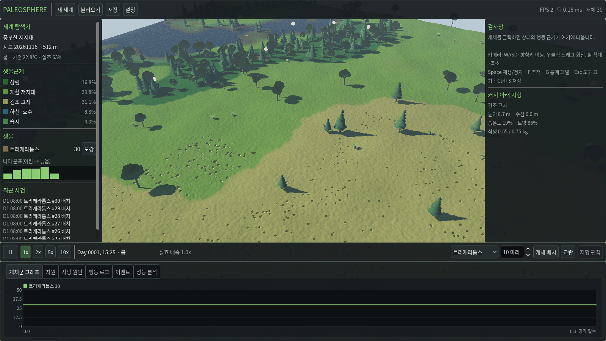
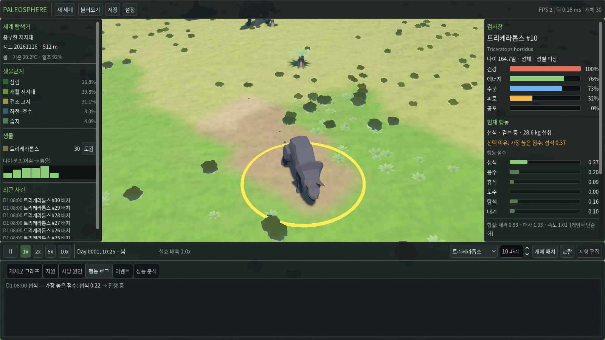

# PALEOSPHERE — 선사 생태계 시뮬레이터

지형과 생물군을 정하면 선사 생물이 스스로 먹고, 마시고, 쉬고, 달아나고, 죽는 과정을 3D로 관찰하는 Windows용 생태계 시뮬레이터입니다. 게임보다 관찰·실험에 무게를 둡니다. 요구사항 원문은 [docs/PLAN.md](docs/PLAN.md)에 있습니다.

**현재 버전 0.1.0은 P0(첫 플레이 가능 버전) 범위입니다.** 초식동물 한 종(트리케라톱스)이 식생·물과 상호작용하는 수직 슬라이스까지 구현했고, 육식동물·번식·지형 편집기 등은 아직 없습니다. 무엇이 되고 무엇이 안 되는지는 아래 표와 [docs/CHANGELOG.md](docs/CHANGELOG.md)에 적었습니다.



> 화면의 공룡은 양식화된 로우폴리 모델입니다(Quaternius, CC0). 속도·대사·수명 같은 수치는 시뮬레이션을 돌리려고 정한 가정이고, 게임 안 도감에서 항목마다 근거 수준(화석으로 확인 / 학술적 추정 / 게임적 단순화)을 표시합니다.



개체는 Quaternius의 리깅 모델(CC0)을 쓰고, 먹기·쉬기 자세는 뼈 보정으로 만듭니다. 땅에는 양치류·속새·덤불이 깔리고, 먹힌 자리는 듬성해집니다(위 그림 가운데의 맨땅). 도감 화면은 [docs/images/codex.png](docs/images/codex.png)에 있습니다.

화면은 GPU가 없는 개발 환경에서 소프트웨어 렌더러로 찍은 것입니다(그래서 FPS 표시가 2입니다).

## 지금 되는 것

| 영역 | 내용 |
|---|---|
| 세계 | 시드 기반 지형(높낮이, 호수, 강, 생물군계 5종), 낮·밤, 날짜·계절, 기온 |
| 식생 | 셀마다 바이오매스가 수분·온도·일조·토양에 따라 자라고 마르며, 먹힌 만큼 실제로 줄어듦 |
| 개체 | 에너지·수분·피로·공포·건강 상태, 섭식·음수·휴식·탐색·도주, 아사·탈수 |
| AI | 행동별 점수를 계산하는 유틸리티 AI와 안전 규칙. 고른 이유와 점수를 검사창에 표시 |
| 화면 | 궤도 카메라, 개체 선택·추적, 검사창, 세계 탐색기, 시간 제어(정지·1x·2x·5x·10x, 실효 배속 표시), 개체 배치, 교란 도구 |
| 분석 | 개체군·식생·평균 상태 그래프, 사망 원인 누계, 나이 분포, 행동 로그, 사건 로그, 틱 처리 시간 |
| 저장 | 스키마 버전·체크섬이 붙은 압축 세이브, 임시 파일 검증 후 교체, 백업 3개, 자동 저장, 손상 시 백업으로 복구 |
| 재현성 | 고정 틱·고정 시드. 같은 시드·설정·명령이면 상태 해시가 같음. Linux와 Windows에서 같은 값이 나오는 것을 CI로 확인 |

## 아직 안 되는 것

- 육식동물, 포식, 번식, 성장 단계, 노화, 사체·분해 (Phase 2~3). 그래서 개체수는 배치하지 않는 한 줄기만 합니다.
- 지형 편집기, 날씨·가뭄, 무리 행동, 기억, 히트맵, A/B 실험 비교, CSV 내보내기 UI (Phase 4~6). `지형 편집` 버튼은 비활성 상태로만 있습니다.
- 경로 탐색은 물까지의 최단 거리장과 직선 조향·장애물 회피만 있습니다. 깊은 물로 갈라진 건너편은 직선으로 걸어갈 수 있을 때만 갑니다.
- 리깅된 3D 모델과 음향은 없습니다. 외부 에셋을 하나도 싣지 않았습니다.

## 검증 상태

| 항목 | 결과 |
|---|---|
| 자동 테스트 164개 (`dotnet test`) | Debug·Release 모두 통과. GitHub Actions의 Ubuntu·Windows 러너에서도 실행 |
| 엔진 안 셀프테스트 (`--selftest`) | 에디터 실행과 내보낸 Linux 실행 파일에서 통과 |
| UI 통합 점검 (`--uitest`, 실제 클릭·키 입력) | 11개 항목 통과 (Linux, 소프트웨어 Vulkan 렌더러) |
| Windows x64 디버그 빌드 | **내보내기까지 성공. 실제 Windows에서 실행해 보지는 못했습니다.** |
| 화면 프레임률 | **미측정.** 개발 환경에 GPU가 없어 소프트웨어 렌더링(2~4 FPS)으로만 띄웠습니다 |
| 틱 처리 시간 | 측정함. [docs/PERFORMANCE.md](docs/PERFORMANCE.md) 참고 |

Windows 실행 확인 방법은 아래 "Windows에서 확인하기"에 있습니다. 결과를 알려 주시면 문서에 반영하겠습니다.

## 개발 환경 구성

필요한 것:

1. **.NET SDK 8.0** — <https://dotnet.microsoft.com/download/dotnet/8.0>
2. **Godot 4.7.2 .NET 버전** (파일 이름에 `mono`가 붙은 것) — <https://godotengine.org/download/archive/4.7.2-stable/>
3. 실행 파일을 만들려면 같은 버전의 **내보내기 템플릿(mono)** — Godot 에디터의 `Editor > Manage Export Templates`에서 설치

```bash
git clone <저장소 주소>
cd <폴더>
dotnet build PaleoSphere.sln          # 코어, 게임, 테스트, 도구 빌드
dotnet test tests/PaleoSphere.Tests.csproj
```

에디터로 열 때는 Godot에서 `project.godot`을 가져오기(Import) 한 뒤 F5를 누릅니다. 명령줄에서는 다음과 같이 실행합니다.

```bash
godot --path .                         # 게임 실행
godot --headless --path . -- --selftest   # 화면 없이 통합 점검
tools/check.sh --with-ui               # 빌드 + 테스트 + 셀프테스트 + UI 점검
```

## Windows 실행 파일 만들기

```bash
tools/export_windows.sh debug          # Linux·macOS
```
```powershell
powershell -ExecutionPolicy Bypass -File tools\export_windows.ps1 -Godot "C:\경로\Godot_v4.7.2-stable_mono_win64_console.exe"
```

`builds/windows/`에 다음이 생깁니다. **세 가지를 같은 폴더에 함께 두어야 실행됩니다.**

- `PaleoSphere.exe` (본체), `PaleoSphere.console.exe` (콘솔 출력용 실행기)
- `PaleoSphere.pck` (씬, 셰이더, data/ JSON)
- `data_PaleoSphere_windows_x86_64/` (.NET 런타임과 게임 DLL. 별도 .NET 설치가 필요 없습니다)

### Windows에서 확인하기

```bat
PaleoSphere.console.exe --headless -- --selftest
PaleoSphere.console.exe -- --uitest
PaleoSphere.exe
```

첫 줄은 데이터 읽기·시뮬레이션·저장·불러오기·재현성을 점검하고 `SELFTEST PASS`를 출력합니다. 둘째 줄은 창을 띄워 클릭·키 입력 경로를 점검하고 `UITEST PASS`를 출력합니다. 프레임률은 게임 안 `성능 분석` 탭이나 `PaleoSphere.console.exe -- --benchmark=100 --seconds=20`으로 잴 수 있습니다.

## 조작

| 입력 | 동작 |
|---|---|
| WASD / 방향키 | 카메라 이동 |
| 우클릭 드래그 | 카메라 회전 |
| 휠 | 확대·축소 |
| 좌클릭 | 개체 선택 (도구가 켜져 있으면 배치·교란) |
| Space | 재생/일시정지 |
| 1 / 2 / 3 / 4 | 1x / 2x / 5x / 10x |
| F | 선택 개체 추적 |
| G | 아래쪽 통계 패널 켜고 끄기 |
| Esc | 도구 끄기 → 시작 창 닫기 → 선택 해제 |
| Ctrl+S | 저장 (마지막에 쓴 이름, 없으면 `quicksave`) |
| Alt+Enter | 전체 화면 전환 |

세이브와 설정은 Windows에서 `%APPDATA%\PaleoSphere\`, Linux에서 `~/.local/share/PaleoSphere/`에 저장됩니다. 프로그램을 지울 때는 실행 폴더와 이 폴더를 지우면 됩니다.

## 폴더 구조

```text
project.godot, PaleoSphere.csproj   Godot 프로젝트 (src/App, src/Presentation, src/UI를 컴파일)
PaleoSphere.sln                     전체 솔루션 (Godot가 요구하는 솔루션 파일을 겸함)
src/PaleoSphere.Sim.csproj          시뮬레이션 코어. Godot에 의존하지 않는 순수 C#
src/Core        시간, 시드 난수, 사건, 상태 해시
src/World       지형 생성, 생물군계, 환경, 격자 탐색
src/Ecology     식생, 개체군 통계
src/Creatures   종 정의, 개체 상태, 생리
src/AI          유틸리티 AI, 행동 실행, 지각, 이동
src/Simulation  틱 루프, 명령, 스냅샷, 고정 틱 누산기, 시나리오
src/Persistence 세이브 직렬화·검증·마이그레이션·파일 저장소
src/Modding     data/ JSON 로더와 검증
src/Diagnostics 로그 출구, 틱 계측
src/App         진입점, 세션, 설정, 셀프테스트 (Godot)
src/Presentation 지형·개체 3D 표시, 카메라, 마우스 선택 (Godot)
src/UI          HUD, 검사창, 그래프, 대화상자, 문구 표 (Godot)
data/           종·생물군계·식생·시나리오 JSON과 검증 스키마
tests/          단위(Unit), 시나리오(Simulation), 저장·데이터(Integration), 세이브 샘플(SaveCompatibility)
tools/          SimRunner(화면 없는 실행·측정 도구), 점검·내보내기 스크립트
docs/           설계·명세·테스트·성능 문서
```

코어의 obj/bin은 `.build/` 아래로 모읍니다. Godot 프로젝트가 저장소 루트의 `.cs`를 모두 긁어 컴파일하므로 코어·테스트·도구 폴더는 `PaleoSphere.csproj`에서 제외했습니다.

## 문제 해결

| 증상 | 확인할 것 |
|---|---|
| 한글이 네모로 보임 | 글꼴 파일을 싣지 않고 운영체제의 한글 글꼴(Windows는 맑은 고딕)을 씁니다. Linux에서는 `fonts-noto-cjk` 등 한글 글꼴을 설치하세요 |
| `no solution file was found` | 저장소 루트의 `PaleoSphere.sln`이 있어야 Godot가 C# 프로젝트를 내보냅니다 |
| 실행하자마자 "데이터 파일 문제" 창 | `data/` JSON이 검증에 걸렸습니다. 창에 파일 이름과 이유가 나옵니다. 스키마는 `data/schemas/` |
| 불러오기 실패 | 원본이 깨졌으면 `.bak1`~`.bak3` 백업을 차례로 시도하고 그 사실을 알립니다. 모두 실패하면 오류 목록이 뜹니다 |
| 10x인데 느림 | 한 프레임에 쓸 수 있는 시뮬레이션 시간을 넘으면 밀린 시간을 버리고 실효 배속을 주황색으로 표시합니다. 설정에서 한도를 바꿀 수 있습니다 |
| 화면이 뜨지 않음(오래된 GPU) | `PaleoSphere.exe --rendering-driver opengl3`로 실행해 보세요 |

## 문서

- [docs/TECH_DECISIONS.md](docs/TECH_DECISIONS.md) — 확인한 도구 버전과 설계 결정
- [docs/TASKS.md](docs/TASKS.md) — P0/P1/P2 작업 목록, 의존성, 진행 상태
- [docs/SIMULATION_SPEC.md](docs/SIMULATION_SPEC.md) — 시뮬레이션 규칙과 가정
- [docs/DATA_SCHEMA.md](docs/DATA_SCHEMA.md) — 데이터 파일과 세이브 형식
- [docs/UI_SPEC.md](docs/UI_SPEC.md) — 화면 구성과 구현 범위
- [docs/TEST_PLAN.md](docs/TEST_PLAN.md) — 테스트 항목별 결과
- [docs/PERFORMANCE.md](docs/PERFORMANCE.md) — 측정치와 목표
- [docs/CHANGELOG.md](docs/CHANGELOG.md) — 변경 이력
- [LICENSES.md](LICENSES.md) — 사용한 도구·라이브러리·에셋의 라이선스
